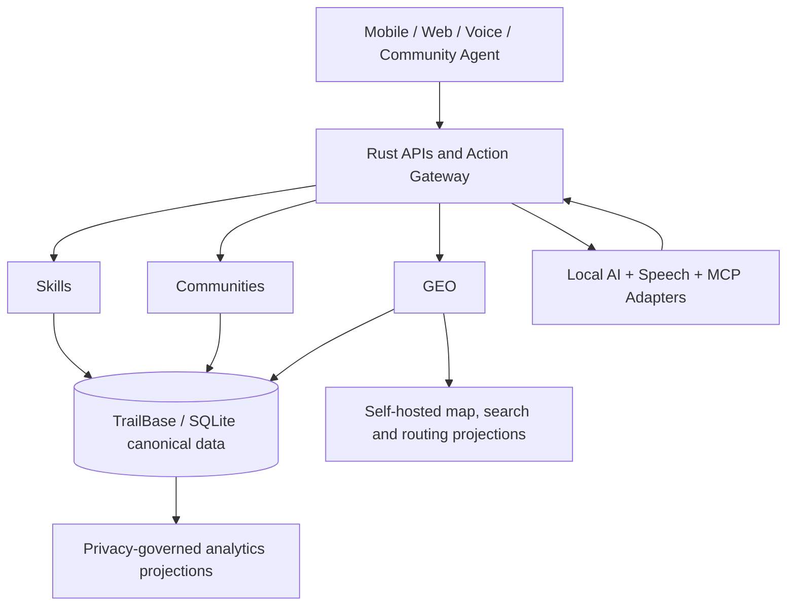

# Rese Rese

**Zimbabwe-first, AI-native, place-aware economic marketplace.**

> **Source of truth:** This Git repository is the living development authority. Read [Documentation Authority](docs/AUTHORITY.md), the [programme charter (review candidate)](docs/charter/programme-charter.md), [binding ADRs](docs/decisions/README.md) and [decision register](docs/governance/decision-register.md) before coding. The preserved [master and technical source specifications](docs/source/README.md) remain historical evidence; newer Owner/ADR decisions prevail.

**Current stage:** Documentation foundation / architectural specification. **Application status:** **Not implemented** (no live Rese Rese backend, TrailBase application schema, AI service or national dataset imports). **Active package:** `RR-GOV-001` — **in_review**, not Owner-approved. **Repository policy:** No changes to Tengasell or any Production environment without separate explicit Owner authorization.

## Purpose

Rese Rese means *anything / any job* in the project's Zimbabwean framing. A person in a village, growth point, mine-adjacent settlement, farm, town, or city should be able to offer legitimate services and goods, find work, reach buyers, access transport, and participate in trusted economic communities—even without a street address, technical literacy, or reliable connectivity.

The core is **one canonical economic knowledge graph**, never three disconnected apps:

| Experience | Core function | Canonical dependencies |
|---|---|---|
| **Rese Rese Skills** | People, occupations, skills, jobs, service listings and professional profiles | Party, Occupation, Skill, Service, Offer, WorkRequest |
| **Rese Rese Communities** | Village, growth point, neighbourhood, producer, buyer, occupational and logistics groups | Place, Community, Group, Membership, Offer, Contract |
| **Rese Rese GEO** | Rural place registry, Location Passport, landmarks, accessible trade routes and economic zones | Place, PlaceName, GeometryAssertion, Provenance, Hub, Route |



## Non-negotiable decisions

- **Rust** for backend, domain logic, intelligence orchestration and primary service code. [ADR-0002](docs/decisions/ADR-0002-rust-trailbase.md).
- **TrailBase + SQLite** as the *canonical* application database/backend foundation. Do not assume Postgres/PostGIS as the primary datastore; older documents predate this decision.
- **Free APIs only:** no required pay-per-call API, paid model access, paid map tiles or proprietary usage quota required for the core product. Self-hosted open-source still has real compute, bandwidth and operations costs. [Free technology policy](docs/architecture/free-technology.md).
- **AI-first but truth-grounded:** AI proposes, interprets and assists; deterministic Rust services with TrailBase authority validate and commit. [AI architecture](docs/architecture/ai-core.md).
- **Place-aware, not city-first:** villages may exist without coordinates; place names are not unique; mapping assertions need sources and review. [GEO architecture](docs/architecture/geo-ai.md).
- **Privacy and human trust:** group membership is not evidence of qualification; no public private-home coordinates or tracking-by-default.
- **No premature Tengasell integration.** This standalone repository is the product building ground. Integration only after a separate authorized review and certified adapter. [ADR-0006](docs/decisions/ADR-0006-tengasell-boundary.md).

## Governing reading order

1. [Documentation precedence](docs/AUTHORITY.md) and [seven accepted ADRs](docs/decisions/README.md) — binding Owner instructions, including **Rust**, **TrailBase/SQLite** and **zero mandatory paid APIs**.
2. [Programme charter](docs/charter/programme-charter.md) — purpose, scope, risks and unresolved approvals (**candidate, not yet signed**).
3. [Decision register](docs/governance/decision-register.md) — accepted constraints vs technical qualifications, legal questions and deferred Tengasell integration.
4. [Development authority](docs/governance/development-authority.md) — SHA custody, one-task branches, independent certification, Production restrictions.
5. [System and canonical architecture](docs/architecture/overview.md) · [Rust/TrailBase proof](docs/architecture/technology-stack.md) · [canonical data](docs/architecture/canonical-data.md) · [AI](docs/architecture/ai-core.md) · [GEO](docs/architecture/geo-ai.md) · [API/MCP](docs/architecture/api-mcp.md).
6. [National taxonomy](docs/taxonomy/README.md), [roadmap and 57-task register](docs/roadmap/README.md), [first-pilot scoring](docs/roadmap/pilot-selection.md) and [release gates](docs/roadmap/release-gates.md).
7. [Evidence protocol](docs/governance/evidence.md), [source/licence register](docs/governance/free-source-register.csv) and [three preserved original specifications](docs/source/README.md).

For a complete navigation table, see [`docs/INDEX.md`](docs/INDEX.md). To publish this prepared local repository to GitHub, use the [one-time publishing guide](PUBLISHING.md).

## Start a new development task

1. Identify the exact task ID in [`docs/roadmap/tasks.csv`](docs/roadmap/tasks.csv), confirm its status, dependencies and explicit dispatch; **do not treat `in_review` as `accepted`**.
2. Read the [development authority](docs/governance/development-authority.md), relevant domain specification, latest ADRs and [`AGENTS.md`](AGENTS.md).
3. State exactly which files, schemas, services and environments you will change; **do not invent a repo state or production authorization**.
4. Work on a named feature branch; implement Rust + TrailBase-first; validate locally with free/open dependencies.
5. Deliver tests, evidence, risks, migration/rollback notes and documentation changes in the same PR.
6. Seek independent certification at the corresponding gate; do not conflate implementation with acceptance.

## Repository navigation

```text
README.md                       Project entrypoint and current constraints
AGENTS.md                       Instructions for AI coding agents and specialists
docs/AUTHORITY.md               Documentation precedence and update discipline
docs/charter/                   Programme charter (review candidate), vision and scope
docs/architecture/              Unified system, Rust/TrailBase, AI, GEO, MCP, APIs
docs/taxonomy/                  Occupations, commodities, places, communities
docs/roadmap/tasks.csv          Machine-readable 57-work-package register
docs/roadmap/release-gates.md   Release and certification criteria
docs/decisions/                 Versioned architecture decision records
docs/governance/                Development authority, decision register, change control, pilot evidence
docs/source/                    Full verbatim master and AI/GEO Markdown sources
tools/docs-check/               Rust documentation validation tool
.github/workflows/              Documentation integrity CI
```

## Local documentation checks

With the free Rust toolchain installed:

```bash
cargo test --workspace
cargo run -p rr-docs-check -- --check
cargo fmt --all -- --check
git diff --check
```

The Rust documentation checker verifies internal Markdown paths, mandatory references and the 57-task register structure; tests/format/diff checks provide additional development hygiene. They do **not** certify application behavior, a field pilot or Owner acceptance.

## Licensing and status

Repository licensing has **not yet been chosen**. No automatic grant is implied for original project text, and third-party datasets, model weights and libraries retain their own licences. Do not bundle third-party artifacts until reviewed in [`docs/governance/free-source-register.csv`](docs/governance/free-source-register.csv).

**Development state:** Documentation-only foundation; no TrailBase migrations, live Rese Rese backend, voice models or geographic data imports have been deployed.