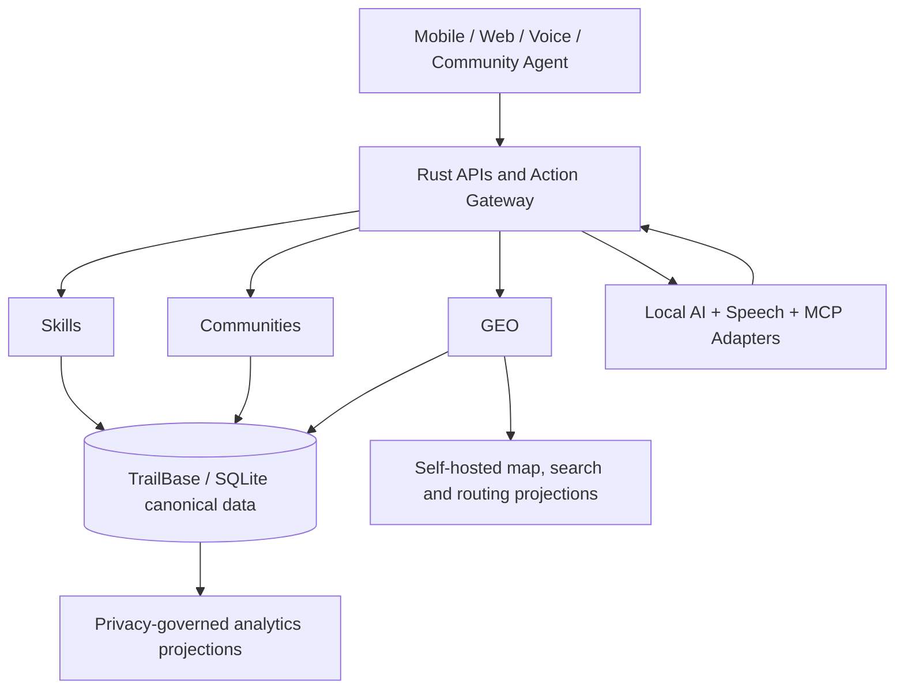

# Rese Rese

**Zimbabwe-first, AI-native, place-aware economic marketplace.**

> **Source of truth:** This repository is the living development authority. Read [Documentation Authority](docs/AUTHORITY.md) first, then the [Programme Roadmap](docs/roadmap/README.md) and relevant architectural decision records. The original master plan and technical specifications are preserved in [`docs/source/`](docs/source/README.md), but updated decisions take precedence.

**Current stage:** Documentation foundation / architectural specification. **Application status:** Not implemented. **Repository policy:** No changes to Tengasell or any Production environment without separate owner authorization.

## Purpose

Rese Rese means *anything / any job* in the project's Zimbabwean framing. A person in a village, growth point, mine-adjacent settlement, farm, town, or city should be able to offer legitimate services and goods, find work, reach buyers, access transport, and participate in trusted economic communities—even without a street address, technical literacy, or reliable connectivity.

The core is **one canonical economic knowledge graph**, never three disconnected apps:

| Experience | Core function | Canonical dependencies |
|---|---|---|
| **Rese Rese Skills** | People, occupations, skills, jobs, service listings and professional profiles | Party, Occupation, Skill, Service, Offer, WorkRequest |
| **Rese Rese Communities** | Village, growth point, neighbourhood, producer, buyer, occupational and logistics groups | Place, Community, Group, Membership, Offer, Contract |
| **Rese Rese GEO** | Rural place registry, Location Passport, landmarks, accessible trade routes and economic zones | Place, PlaceName, GeometryAssertion, Provenance, Hub, Route |



## Non-negotiable decisions

- **Rust** for backend, domain logic, intelligence orchestration and primary service code. [ADR-0002](docs/decisions/ADR-0002-rust-trailbase.md).
- **TrailBase + SQLite** as the *canonical* application database/backend foundation. Do not assume Postgres/PostGIS as the primary datastore; older documents predate this decision.
- **Free APIs only:** no required pay-per-call API, paid model access, paid map tiles or proprietary usage quota required for the core product. Self-hosted open-source still has real compute, bandwidth and operations costs. [Free technology policy](docs/architecture/free-technology.md).
- **AI-first but truth-grounded:** AI proposes, interprets and assists; deterministic Rust services with TrailBase authority validate and commit. [AI architecture](docs/architecture/ai-core.md).
- **Place-aware, not city-first:** villages may exist without coordinates; place names are not unique; mapping assertions need sources and review. [GEO architecture](docs/architecture/geo-ai.md).
- **Privacy and human trust:** group membership is not evidence of qualification; no public private-home coordinates or tracking-by-default.
- **No premature Tengasell integration.** This standalone repository is the product building ground. Integration only after a separate authorized review and certified adapter. [ADR-0006](docs/decisions/ADR-0006-tengasell-boundary.md).

## Read the plan in this order

1. [Documentation authority and precedence](docs/AUTHORITY.md) — what governs when files conflict.
2. [Vision and scope](docs/charter/vision.md) — users, economic cases, products and exclusions.
3. [System architecture](docs/architecture/overview.md) — technical boundaries and data flows.
4. [Rust and TrailBase](docs/architecture/technology-stack.md) — implementation baseline and risks.
5. [AI and multilingual voice](docs/architecture/ai-core.md) + [GEO and mapping AI](docs/architecture/geo-ai.md).
6. [National taxonomy](docs/taxonomy/README.md) — jobs, goods, geography and groups.
7. [Roadmap and task registry](docs/roadmap/README.md) — 49 inherited tasks plus Rust/TrailBase adjustments.
8. [Release gates](docs/roadmap/release-gates.md) and [verification](docs/governance/evidence.md).
9. [Source plan and specifications](docs/source/README.md) — full preserved original material and technical references.

For a complete navigation table, see [`docs/INDEX.md`](docs/INDEX.md). To publish this prepared local repository to GitHub, use the [one-time publishing guide](PUBLISHING.md).

## Start a new development task

1. Identify the task ID in [`docs/roadmap/tasks.csv`](docs/roadmap/tasks.csv) and its dependencies.
2. Read the relevant domain specification, latest ADRs and [`AGENTS.md`](AGENTS.md).
3. State exactly which files, schemas, services and environments you will change; **do not invent a repo state or production authorization**.
4. Work on a named feature branch; implement Rust + TrailBase-first; validate locally with free/open dependencies.
5. Deliver tests, evidence, risks, migration/rollback notes and documentation changes in the same PR.
6. Seek independent certification at the corresponding gate; do not conflate implementation with acceptance.

## Repository navigation

```text
README.md                       Project entrypoint and current constraints
AGENTS.md                       Instructions for AI coding agents and specialists
docs/AUTHORITY.md               Documentation precedence and update discipline
docs/charter/                   Product charter and scope
docs/architecture/              Unified system, Rust/TrailBase, AI, GEO, MCP, APIs
docs/taxonomy/                  Occupations, commodities, places, communities
docs/roadmap/tasks.csv          Machine-readable 49+ named work-package register
docs/roadmap/release-gates.md   Release and certification criteria
docs/decisions/                 Versioned architecture decision records
docs/governance/                Change control and independent evidence
docs/source/                    Full verbatim master and AI/GEO Markdown sources
tools/docs-check/               Rust documentation validation tool
.github/workflows/              Documentation integrity CI
```

## Local documentation checks

With the free Rust toolchain installed:

```bash
cargo test -p rr-docs-check
cargo run -p rr-docs-check -- --check
```

These verify documentation anchors/files, mandatory references and the task-register structure; they do **not** certify the application (which is not yet implemented).

## Licensing and status

Repository licensing has **not yet been chosen**. No automatic grant is implied for original project text, and third-party datasets, model weights and libraries retain their own licences. Do not bundle third-party artifacts until reviewed in [`docs/governance/free-source-register.csv`](docs/governance/free-source-register.csv).

**Development state:** Documentation-only foundation; no TrailBase migrations, live Rese Rese backend, voice models or geographic data imports have been deployed.