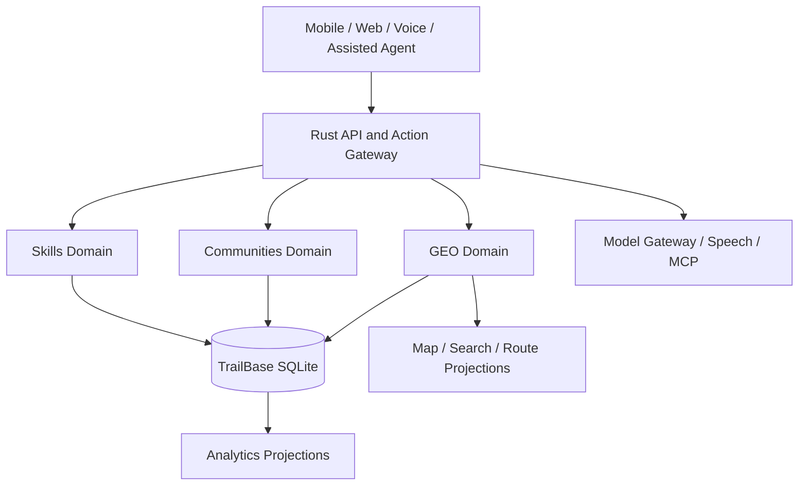

# Unified system architecture

**Decision:** One AI-native marketplace domain and canonical economic knowledge graph, not three independently owned products.

## Domain invariants
- Permanent canonical IDs for Party, ProviderCapability, Occupation, Skill, ServiceDefinition, Offer, WorkRequest, Place, Group, Membership, TransportNode, EconomicZone and verified work.
- Canonical data is versioned and permissioned. Relations are temporal where geographic/organizational membership changes.
- One listing can be shared to many groups without multiplying stock or ownership.
- Provider claims, group membership and professional qualifications are different evidence categories.
- An unmapped village remains valid as a Place with no fabricated coordinate.
- AI can interpret and propose; deterministic Rust authorized services commit.
- Integrations must preserve exact original entity IDs, source provenance, permissions and transaction audit.

## Deployment
Begin with a modular Rust workspace and pinned TrailBase/SQLite; separately evaluate map/AI workers as derived services. Avoid microservices proliferation without measured need. Route and tile engines are projections, not writable authoritative geographic registries.

Read [technology stack](technology-stack.md), [AI](ai-core.md), [GEO](geo-ai.md), [API/MCP](api-mcp.md), [canonical data](canonical-data.md).
